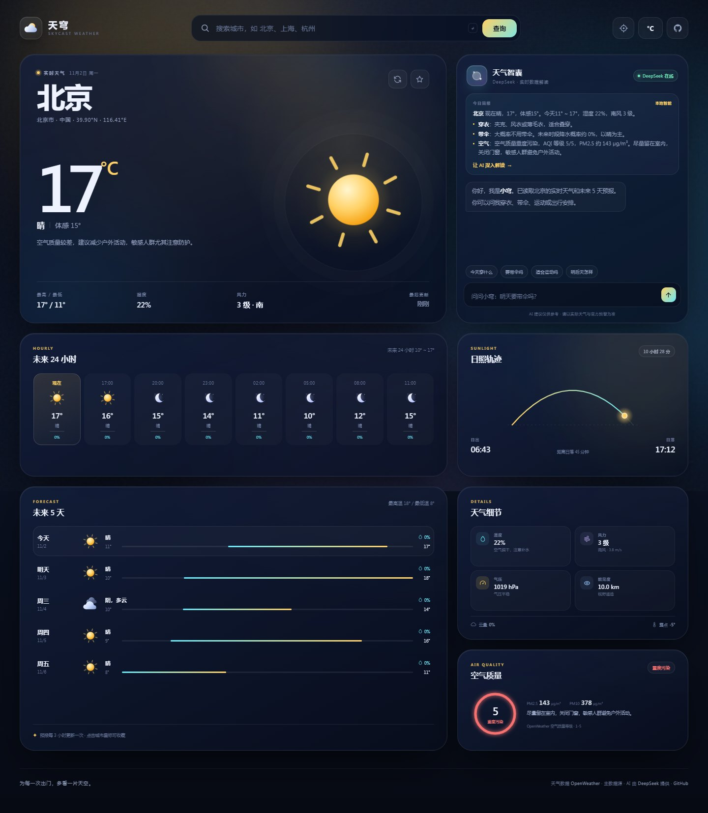
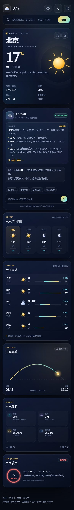

# 天穹天气 · Skycast Weather

一个中文优先的天气仪表盘：中文城市搜索、实时天气、24 小时趋势、未来 5 天预报、空气质量，以及接入 DeepSeek 的 AI 天气助手。

[在线体验](https://www.wethdbd.top/) · [GitHub Pages](https://cochyu.github.io/Weather-Dashboard/) · [项目源码](https://github.com/cochyu/Weather-Dashboard)



## ✨ 功能

- **中文城市搜索**：内置 60+ 常用中文城市坐标，同时接入 OpenWeather 中文地名；输入「北京」「杭州」「伦敦」都能查。
- **实时天气**：温度、体感、天气现象、最高/最低温、湿度、风力、气压、能见度、云量、露点。
- **24 小时趋势**：按 3 小时颗粒度展示未来时段、天气图标、气温和降水概率。
- **未来 5 天**：每日天气、温度区间条、降水概率，一眼看出升降温与雨天。
- **日照轨迹**：日出日落、白昼时长、太阳当前在天空中的位置。
- **空气质量**：AQI 等级环、PM2.5 / PM10、健康建议。
- **DeepSeek 天气助手**：结合当前城市实时数据回答穿衣、带伞、运动、出行、空气质量等问题。
- **本地智能简报**：Worker 暂时不可用时也能生成可执行的天气建议，不会出现空白面板。
- **细节体验**：动态天气主题、响应式布局、摄氏度/华氏度切换、城市收藏、最近搜索、定位、键盘操作、减少动效支持。

## 🖥 预览

| 桌面端 | 移动端 |
| --- | --- |
|  |  |

## 🧱 技术栈

- 原生 HTML / CSS / JavaScript（ES Modules，无前端框架、无构建步骤）
- [OpenWeather API](https://openweathermap.org/)：实时天气、5 天预报、空气质量、中文地名
- [Open-Meteo](https://open-meteo.com/)：OpenWeather 暂不可用时的免 Key 兜底数据源
- [DeepSeek API](https://www.deepseek.com/)：AI 天气助手
- Node.js 原生 HTTP 服务：本地开发与自托管 AI 代理
- Cloudflare Worker：生产环境天气 + DeepSeek 代理（已部署，含自定义域名）
- GitHub Pages：静态站点托管

## 🔐 API Key 隔离设计

这是本项目最重要的工程约束：

| 服务 | Key 存放位置 | 是否进入前端 | 说明 |
| --- | --- | --- | --- |
| OpenWeather | Cloudflare Worker Secret | **否** | Worker 代理天气，浏览器不直连 OpenWeather |
| DeepSeek | Cloudflare Worker Secret / 本地 `.env` | **否** | 只由 Worker 读取，前端只请求 `/api/ai` |

- 前端没有任何 OpenWeather 或 DeepSeek Key，也没有 API 地址或 Key 的配置入口。
- `server/server.mjs` 和 `worker/worker.js` 共用 `shared/ai-core.mjs`，系统提示词、上下文格式、DeepSeek 调用和错误处理只维护一份。
- AI 接口有来源白名单、请求体校验、上下文裁剪和简单频率限制。
- 线上天气和 AI 都通过已部署的 Cloudflare Worker 调用；如果 Worker 暂时不可用，页面自动回退到本地智能简报。
- GitHub Pages 只负责静态页面，**不会接触任何 API Key**。

### 为什么能解决中国大陆访问

`api.openweathermap.org` 在中国大陆经常无法直连。现在的链路是：

```text
浏览器 → api.wethdbd.top（Cloudflare 自定义域名）
       → Cloudflare Worker（境外出口）
       → api.openweathermap.org
```

浏览器不再直接请求 OpenWeather，所以大陆网络环境也能拿到天气数据。`workers.dev` 域名作为备用，自定义域名优先。

> 请不要把 `.env`、`worker/.dev.vars` 或真实 DeepSeek Key 提交到 Git。仓库已通过 `.gitignore` 排除这些文件。

## 🚀 本地运行

要求 Node.js 20+。

```bash
git clone https://github.com/cochyu/Weather-Dashboard.git
cd Weather-Dashboard
copy .env.example .env      # Windows
# cp .env.example .env      # macOS / Linux
```

编辑 `.env`：

```env
DEEPSEEK_API_KEY=sk-your-deepseek-api-key
DEEPSEEK_MODEL=deepseek-chat
PORT=8787
```

启动：

```bash
npm run dev
```

打开 <http://127.0.0.1:8787>。前端默认请求线上 Cloudflare Worker，所以天气和 AI 都会直接可用；本地 Node 服务仍保留 `/api/ai`，可用于调试代理。

语法检查：

```bash
npm run check
```

## ☁️ 部署到 GitHub Pages

项目没有构建步骤，直接把仓库根目录发布到 Pages 即可。

1. 将代码推送到 `main` 分支。
2. 仓库 **Settings → Pages**：
   - Source: `Deploy from a branch`
   - Branch: `main`
   - Folder: `/ (root)`
3. 等待 Pages 构建完成，访问 <https://cochyu.github.io/Weather-Dashboard/>。
4. 仓库内的 `CNAME` 已绑定自定义域名 `www.wethdbd.top`，如不需要可删除。

## 🤖 Cloudflare Worker（天气 + AI，已部署）

线上 Worker 自定义域名：

```text
https://api.wethdbd.top
```

- 天气：`/api/weather`、`/api/geocode`、`/api/reverse`
- AI：`/api/ai`
- 健康检查：`/api/health`

当前线上页面不再提供代理地址或 API Key 配置入口。需要重新部署或迁移 Worker 时：

```bash
# 首次使用会打开浏览器登录 Cloudflare
npx wrangler login

# 部署代理（wrangler.toml 内已声明 api.wethdbd.top 自定义域名）
npx wrangler deploy -c worker/wrangler.toml

# 写入/更新服务端 Secret（不会出现在代码或前端）
npx wrangler secret put DEEPSEEK_API_KEY -c worker/wrangler.toml
npx wrangler secret put OPENWEATHER_API_KEY -c worker/wrangler.toml
```

如果 Worker 名称或自定义域名变化，只需同步修改 `assets/js/config.js`：

```js
weather: {
  apiBase: 'https://api.wethdbd.top',
  fallbackBase: 'https://your-worker.your-subdomain.workers.dev',
  lang: 'zh_cn',
  units: 'metric'
},
ai: {
  proxyUrl: 'https://api.wethdbd.top/api/ai',
  fallbackProxyUrl: 'https://your-worker.your-subdomain.workers.dev/api/ai',
  model: 'deepseek-chat',
  maxHistory: 8
}
```

Worker 的允许来源在 `worker/wrangler.toml` 的 `ALLOWED_ORIGINS` 中配置，默认已包含：

- `https://cochyu.github.io`
- `https://www.wethdbd.top`
- `https://wethdbd.top`
- 本地 `localhost:8787` / `127.0.0.1:8787`

## 🩺 数据源兜底

1. 浏览器优先请求 `https://api.wethdbd.top/api/weather`，由 Worker 调用 OpenWeather，保留完整的中文天气描述、空气质量和 5 天预报。
2. 如果自定义域名、Worker 或 OpenWeather 暂时不可用，前端会尝试 `workers.dev` 备用地址，再回退到 Open-Meteo（免 Key），把返回数据归一化成 OpenWeather 的数据结构；页面底部会显示「Open-Meteo 备用源」。
3. 中文城市搜索在 Worker 地理编码失败时，也会回退到 Open-Meteo Geocoding。

要更换 OpenWeather Key，不需要改前端，直接更新 Worker Secret：

```bash
npx wrangler secret put OPENWEATHER_API_KEY -c worker/wrangler.toml
```

## 📁 项目结构

```text
Weather-Dashboard/
├─ index.html                 # 页面骨架
├─ assets/
│  ├─ css/style.css           # 视觉系统、响应式、动效
│  ├─ js/
│  │  ├─ app.js               # 页面状态与交互
│  │  ├─ api.js               # Worker 天气代理 / Open-Meteo 兜底
│  │  ├─ ai.js                # AI 对话、Worker 探测、本地智能简报
│  │  ├─ cities.js            # 中文城市库与搜索结果整理
│  │  ├─ icons.js             # 内联 SVG 天气图标与 UI 图标
│  │  ├─ config.js            # 公开前端配置（Worker 地址，不含 Key）
│  │  └─ utils.js             # 时间、温度、风、AQI、文本渲染工具
│  └─ img/                    # README 预览图
├─ server/server.mjs          # 本地开发 / 自托管服务器 + AI 代理
├─ shared/ai-core.mjs         # Node 与 Worker 共用的 DeepSeek 逻辑
├─ worker/                    # Cloudflare Worker（weather.js + AI 代理）
├─ .env.example               # 服务端环境变量模板
├─ CNAME                      # GitHub Pages 自定义域名
└─ package.json
```

## 🧠 AI 助手如何工作

1. 页面把当前城市、实时天气、未来时段、5 天预报、空气质量整理成精简的 JSON 上下文。
2. 请求 Cloudflare Worker 的 `/api/ai`（本地开发时也可以由 Node 服务提供同源 `/api/ai`）。
3. 服务端把上下文转成中文提示词，调用 DeepSeek `deepseek-chat`，返回纯文本。
4. 前端用安全的轻量 Markdown 渲染器展示回复，不直接插入未转义的 HTML。
5. Worker 不可用时，前端使用同一份天气上下文生成规则化简报，保证页面始终可用。

## 📌 说明

- 天气数据来自 OpenWeather，备用数据来自 Open-Meteo；AI 内容由 DeepSeek 生成，仅供参考。
- 页面不包含广告、追踪脚本或第三方统计。
- 如果遇到 Key 失效，请先在 OpenWeather 控制台确认 Key 已激活、未受限；再更新 Worker 的 `OPENWEATHER_API_KEY` Secret。
- 建议定期轮换 API Key，尤其是曾经在聊天、截图或日志中出现过的 Key。

## License

MIT
